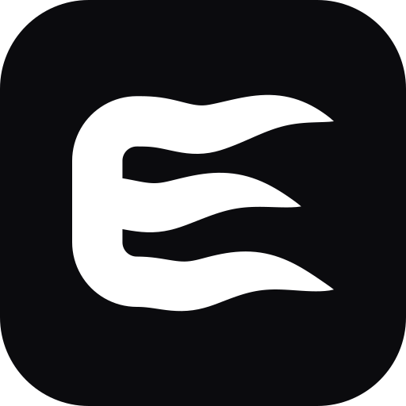
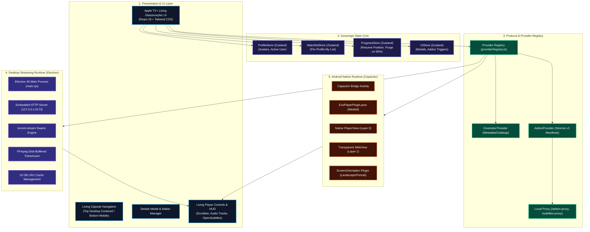
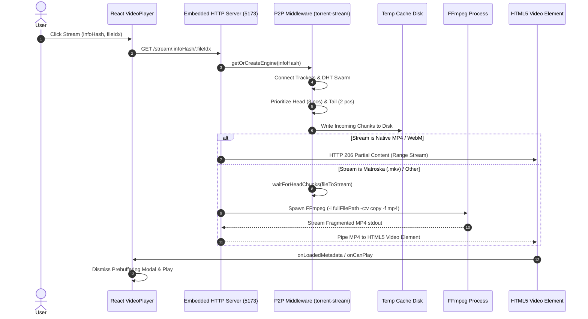
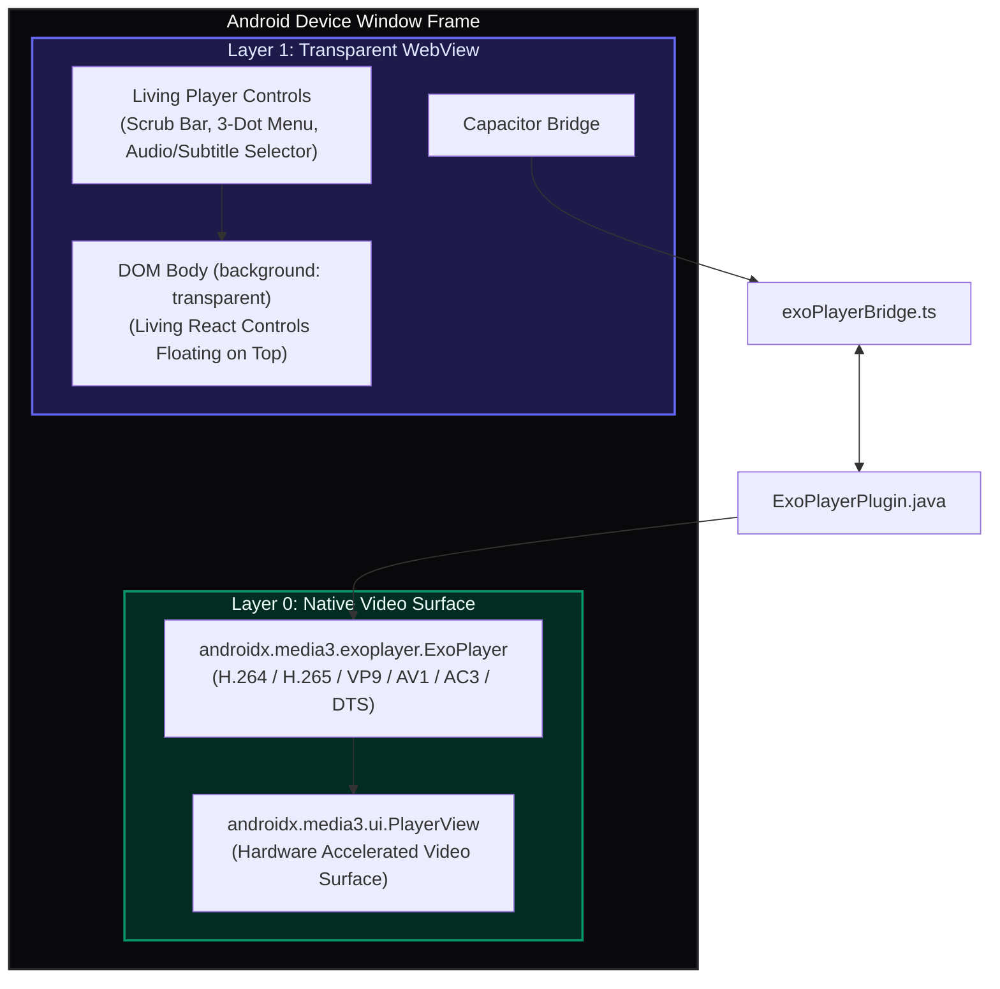

# Endless Stream

<p align="center">
  
</p>

<p align="center">
  <strong>Next-Generation Open Streaming Platform with Living Glassmorphism Architecture</strong>
</p>

<p align="center">
  Zero Subscription Cost &bull; Sovereign Stremio Freedom Model &bull; Native BitTorrent P2P Engine &bull; Dual Desktop & Android Runtime
</p>

---

> [!NOTE]
> **Project Status (Paused / Future Roadmap)**  
> As of Release V1.0, active development on Endless Stream is paused for future review. This document serves as the comprehensive architectural blueprint, detailing the implemented frontend, native desktop/mobile engines, data flow pipelines, and technical trade-offs.

---

## 1. System Architecture Overview

Endless Stream is organized into five decoupled layers spanning the presentation layer, sovereign state, protocol dispatch, desktop embedded streaming engine, and the native Android Media3 ExoPlayer bridge.



---

## 2. The Stremio Sovereign Freedom Model

Following the Stremio architectural paradigm, Endless Stream strictly separates client software from content indexes:

1. **Zero Pre-bundled Scrapers**: Out of the box, the client bundles zero scrapers, torrent aggregators, or private indexes.
2. **Standard Stremio v3 Protocol**: The application speaks the open Stremio JSON protocol (`/manifest.json`, `/catalog/...`, `/meta/...`, `/stream/...`, `/subtitles/...`).
3. **User-Controlled Extensions**: Users configure add-ons via the visual Addon Manager. All manifests are persisted locally in `localStorage` under `endless_stream:addon_urls`.
4. **Zero-Addon Baseline**: Users retain full capability to purge all installed add-ons back to zero at any time.

```mermaid
flowchart LR
    User["User"]
    AddonModal["Addon Manager Modal"]
    LocalStore["localStorage<br/>(endless_stream:addon_urls)"]
    Registry["ProviderRegistry"]
    Manifest["Community Manifest URL<br/>(manifest.json)"]
    Streams["Stream Resolution Pipeline"]

    User -->|Paste URL or Install| AddonModal
    AddonModal -->|Validate Manifest| Manifest
    Manifest -->|Save Valid URL| LocalStore
    LocalStore -->|Hydrate| Registry
    Registry -->|Query Streams| Streams

    classDef defaultStyle fill:#18181b,stroke:#a1a1aa,stroke-width:1px,color:#f4f4f5;
    classDef accentStyle fill:#1e1b4b,stroke:#6366f1,stroke-width:2px,color:#f8fafc;
    classDef greenStyle fill:#064e3b,stroke:#10b981,stroke-width:2px,color:#f8fafc;

    class User,AddonModal defaultStyle;
    class LocalStore,Registry accentStyle;
    class Manifest,Streams greenStyle;
```



---

## 3. Desktop Streaming Engine (Electron & P2P)

On Windows Desktop, Endless Stream operates an embedded loopback server with an integrated BitTorrent client and on-the-fly media transmuxer.



### Key Technical Properties:
- **Disk-Buffered Remuxing**: Reading directly from disk (`-i fullFilePath` with `-probesize 1M -analyzeduration 1M -fflags +nobuffer+fastseek`) eliminates stream starvation associated with unseekable pipes.
- **HTTP 206 Range Streaming**: For MP4 files, Range requests (`bytes=start-end`) enable instantaneous seeking without invoking FFmpeg.
- **10 GB LRU Cache**: Background cleaner tracks file access timestamps and automatically purges inactive chunks when disk consumption exceeds 10 GB.

---

## 4. Android Native Architecture (Media3 ExoPlayer)

On Android, Endless Stream compiles into a native APK using Capacitor, leveraging Google's **Media3 ExoPlayer** for hardware-accelerated video rendering.



### Android Enhancements in V1.0:
1. **Cleartext Traffic Support**: `android:usesCleartextTraffic="true"` configured in `AndroidManifest.xml` to allow HTTP/P2P local streaming endpoints.
2. **Transparent WebView Stacking**: Dynamic toggling of `document.body` and `document.documentElement` background colors to `transparent` during playback, allowing the native `PlayerView` beneath the WebView to remain visible.
3. **Network DataSource Configuration**: `DefaultHttpDataSource.Factory` configured with `allowCrossProtocolRedirects(true)` and standardized mobile User-Agent.
4. **Orientation Lock**: Dynamic toggling between portrait and landscape modes using `@capacitor/screen-orientation`.
5. **Locked JDK 17 Toolchain**: `android/gradle.properties` locks the Gradle daemon JVM to Amazon Corretto JDK 17 to prevent Java 25 class file semantic analysis incompatibilities.

---

## 5. Repository File Structure

```
ProjectX/
├── android/                         # Native Android Capacitor Project
│   ├── app/
│   │   ├── build.gradle             # Android app build configuration (Media3 dependencies)
│   │   └── src/main/
│   │       ├── AndroidManifest.xml  # Cleartext HTTP & permissions
│   │       └── java/com/endless/stream/
│   │           ├── MainActivity.java     # BridgeActivity with 60+ FPS display refresh
│   │           └── ExoPlayerPlugin.java  # Native Media3 ExoPlayer bridge
│   ├── build_apk.bat                # Automated Android APK compilation script
│   └── gradle.properties            # JDK 17 daemon lock
├── electron/
│   ├── main.cjs                     # Electron main process & embedded server
│   └── preload.cjs                  # Secure context isolation bridge
├── server/
│   ├── p2pMiddleware.js             # BitTorrent swarm engine & FFmpeg transmuxer
│   └── streamServer.js              # Standalone streaming server wrapper
├── src/
│   ├── app/                         # Application root, routing, UI stores
│   ├── data/                        # Content providers, hooks, cache, Stremio addon registry
│   ├── details/                     # Content details modal & episode picker
│   ├── pages/                       # Home, Movies, TV Shows, Search, My List
│   ├── player/                      # VideoPlayer, LoomBoxLoading, ExoPlayer bridge
│   ├── profiles/                    # Multi-profile system, watchlist & progress stores
│   └── ui/                          # Apple TV+ glassmorphism components (Navbar, Hero, Row, PosterCard)
├── package_desktop.cjs              # Electron standalone packager script
└── vite.config.ts                   # Vite configuration with Tailwind CSS v4
```

---

## 6. Build Instructions

### Prerequisites
- **Node.js**: v18.0.0 or higher
- **JDK**: Amazon Corretto JDK 17 (Required for Android builds)
- **Git**: Installed on PATH

### Development Server
```bash
npm install
npm run dev
```

### Building Windows Desktop Standalone (.exe)
```bash
node package_desktop.cjs
```
Output: `release-builds/Endless Stream-win32-x64/Endless Stream.exe`

### Building Android APK (.apk)
```bash
npm run build
npx cap sync android
cmd /c "build_apk.bat"
```
Output: `android/app/build/outputs/apk/debug/app-debug.apk`

---

## 7. Known Technical Limitations & Future Work

1. **Torrent Swarm Cold Starts**: Swarms with low seed counts take time to gather initial pieces. A persistent distributed metadata cache or web-seed integration would accelerate startup times.
2. **Real-time Remuxing on Unfinished Files**: Incomplete MKV containers require robust cue probing to prevent FFmpeg pipeline stalls when seeking into unbuffered piece boundaries.
3. **Android Background Torrent Daemon**: Native Android playback functions best with direct HTTP/Debrid streams. Full standalone BitTorrent streaming on mobile would benefit from an embedded native C++ libtorrent daemon.

---

## 8. License

Distributed under the MIT License. Endless Stream does not host, provide, or scrape copyrighted media streams. All catalogs and streams are managed through third-party community add-ons under user sovereignty.
