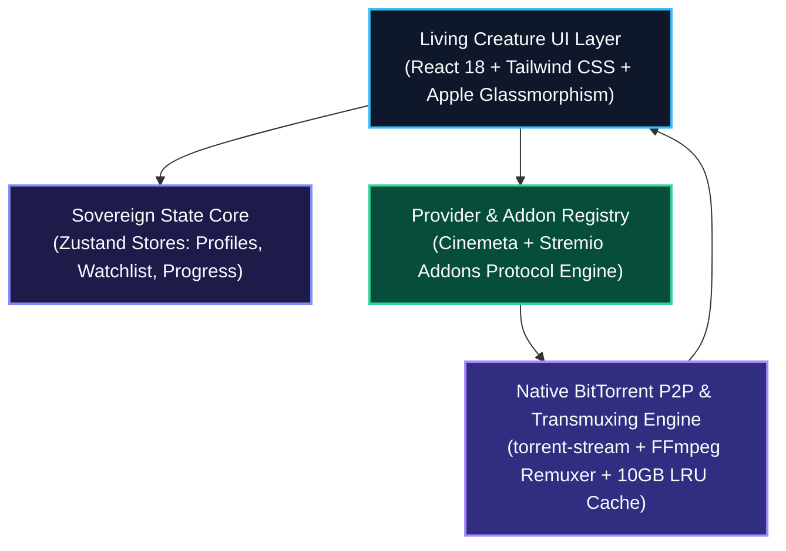
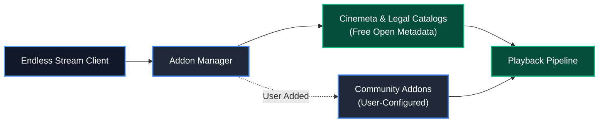
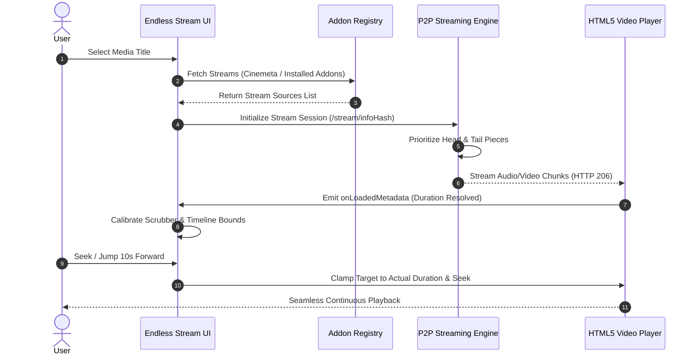

# Endless Stream

<p align="center">
  
</p>

<p align="center">
  <strong>Next-Generation Open Streaming Platform with Living Glassmorphism Architecture</strong>
</p>

<p align="center">
  Zero Subscription Cost &bull; Sovereign Stremio Freedom Model &bull; Native BitTorrent P2P Engine &bull; Zero External Dependencies
</p>

---

## Executive Overview

Endless Stream is a high-performance open-source streaming ecosystem engineered from the ground up to deliver a premium, Apple TV+ living creature glassmorphic experience on Windows Desktop, Android, and Web platforms.

Built upon an unbundled, zero-cost freedom architecture, Endless Stream functions identically to Stremio: the application hosts, bundles, and maintains zero stream scrapers, torrent indexes, or third-party media hosts out of the box. Instead, Endless Stream provides pure, open technology. Users are equipped with an open Addon Engine compatible with standard Stremio v3 manifests, allowing total sovereignty to install community add-ons (such as Anime Kitsu, CyberFlix, or custom manifests) directly from the visual Addon Manager.

Out of the box, the system starts as a clean slate (0 pre-bundled add-ons) and connects to zero external services until configured by the user, ensuring legal compliance, zero subscription requirements, and absolute user freedom. Users can install official or community manifests with a single tap in the Addon Manager, or clear all add-ons back to zero at any time.

---

## Architectural Systems

The Endless Stream ecosystem is organized into four core layers: presentation, state management, provider dispatch, and the background native P2P streaming runtime.



---

## The Stremio Freedom Model

In strict alignment with the Stremio philosophy, Endless Stream strictly decouples the client technology from content scraping:

1. **Zero Pre-bundled Torrent Scrapers**: Endless Stream never bundles torrent scrapers, aggregators, or unauthorized third-party indexes.
2. **Open Addon Protocol**: The client natively interprets Stremio v3 manifest schemas (`manifest.json`), supporting `catalog`, `meta`, `stream`, and `subtitles` resource directives.
3. **User Sovereignty**: Users retain complete discretion to paste any community manifest URL or install popular community add-ons with a single tap in the Addon Manager.
4. **Local Execution**: All addon queries execute directly from your client machine; no centralized tracking or intermediary telemetry exists.



---

## Core Capabilities

### Living Creature Design System
- Apple TV+ Inspired Glassmorphism: Multi-layered background blurs, frosted capsules, dynamic ambient hero lighting, and fluid physics.
- Responsive Cross-Platform Navigation: Smooth adaptive layouts across 4K Desktop monitors, laptops, tablets, and handheld mobile viewports.
- Authentic Portrait Movie Posters: Handheld mobile views present authentic 2:3 vertical posters with transparent title branding logos, eliminating cluttered synopsis blocks and horizontal distortion.
- Living Dynamic Hero Banner: Rotates featured content automatically every 4 hours, presenting clean cinema artwork with zero watermark artifacts.
- Solid Background 2D Animal Portrait Illustrations: Custom regal 2D graphic portraits for user profiles (Lion, Fox, Wolf, Snow Leopard, Barn Owl, Black Panther) on flat solid background colors.

### Precision Video Player Engine
- Media3 ExoPlayer Android Backend: Native Android APK utilizes Google's lightweight open-source ExoPlayer under a transparent WebView for hardware-accelerated torrent playback, AC3/EAC3/DTS audio decoding, and instant seeking without altering UI/UX.
- Multi-Audio Track Selection: Battle-tested audio track switching supporting multi-channel surround sound (5.1, 7.1), language variants, and commentary tracks on both Android and Desktop.
- Mobile 3-Dot Options Capsule: Eliminates mobile viewport crowding by consolidating Audio Tracks, OpenSubtitles, and Stream Selection into a sleek Apple TV+ bottom sheet.
- Dynamic Screen Rotation: Integrated horizontal landscape rotation allows one-tap full-width cinema playback on handheld Android devices and tablets.
- Universal Seeking Architecture: Native HTTP 206 Partial Content range seeking combined with intelligent pre-buffering.
- Dynamic Duration Synchronization: Overcomes variable episode duration mismatches by binding directly to media duration upon container header resolution.
- Fluid Scrub Scrubber: Real-time dragging feedback without socket saturation or FFmpeg stalls.
- Integrated OpenSubtitles v3: Automatically fetches, parses, and styles SRT subtitles with live synchronization offset adjustments and customizable typography.
- Swarm Telemetry Drawer: Real-time peer counts, download speeds, upload speeds, and chunk verification stats accessible during playback.

### High-Performance P2P Engine & Transmuxing
- Direct BitTorrent Swarm Integration: Uses `torrent-stream` to connect directly to public trackers (opentrackr, demonii, stealth.si) with 120 concurrent connections.
- Intelligent Piece Prioritization: Automatically prioritizes head pieces (first 8 pieces) for instant playback startup and tail pieces for MP4 index atoms.
- On-The-Fly Transmuxing: FFmpeg pipeline seamlessly remuxes Matroska (.mkv) and AVI containers to fragmented MP4 in memory without disk bloating.
- 10GB LRU Disk Cache: Automatic Least-Recently-Used cache pruner keeps local disk usage constrained below 10 GB.

---

## Data Flow Pipeline



---

## Setup & Local Development

### System Requirements
- Operating System: Windows 10/11, macOS 12+, or Modern Linux
- Node.js: v18.0.0 or higher
- Git: Installed and configured on your system PATH
- Java Development Kit: Amazon Corretto 17 or OpenJDK 17 (Required for Android APK builds)
- Android SDK: Command-line tools or Android Studio (Required for Android builds)

### Installation

Clone the repository and install runtime dependencies:

```bash
git clone https://github.com/Endless-Code-Horizon/Endless-Stream.git
cd Endless-Stream
npm install
```

### Running the Development Server

Start the local development server with the integrated P2P streaming middleware:

```bash
npm run dev
```

The application will be accessible at:
```
http://localhost:5173
```

---

## Desktop Windows Executable Build

Endless Stream features a standalone desktop packaging pipeline built on Electron. The desktop package includes an embedded HTTP streaming server running on loopback, completely self-contained.

### Building the Desktop Executable

Run the desktop packaging script:

```bash
node package_desktop.cjs
```

The compiled standalone executable and runtime assets are emitted to:
```
release-builds/Endless Stream-win32-x64/Endless Stream.exe
```

No external installations or browser dependencies are required on the host Windows system.

---

## Android APK Build

Endless Stream utilizes Capacitor to compile the modern web application into a high-performance native Android package.

### Compiling the Android APK

1. Ensure Java 17 and Android SDK licenses are accepted:
```bash
node -e "const fs = require('fs'); const path = require('path'); const lic = path.join(process.env.LOCALAPPDATA, 'Android', 'Sdk', 'licenses'); fs.mkdirSync(lic, { recursive: true }); fs.writeFileSync(path.join(lic, 'android-sdk-license'), '8937372298271af1b764f22630f97ea200844f28\n24333f8a63b6825ea9c5514f83c2829b004d1fee\nd56f5187479451eabf01fb78af6dfcb131a6481e\n84831b9409646a918e30573bab4c9c91346d8abd', 'utf8');"
```

2. Sync web distribution assets with the Android native project:
```bash
npm run build
npx cap sync android
```

3. Compile the debug APK using Gradle:
```bash
cmd /c "build_apk.bat"
```

The generated APK is located at:
```
android/app/build/outputs/apk/debug/app-debug.apk
```

---

## Frequently Asked Questions (Q&A)

### General

#### Is Endless Stream completely free?
Yes. Endless Stream is 100% free and open-source software under the MIT License. There are no paywalls, premium tiers, or hidden subscriptions.

#### Does Endless Stream require Real-Debrid, AllDebrid, or Premiumize?
No. Endless Stream features its own built-in native BitTorrent P2P streaming engine. You can stream directly from peer-to-peer swarms at $0 cost without any third-party debrid accounts. If an addon provides direct HTTP debrid streams, Endless Stream will play them natively as well.

#### What addons can I use with Endless Stream?
Endless Stream is compatible with all standard Stremio v3 community addons. This includes Anime Kitsu, CyberFlix, OpenSubtitles, WatchHub, and custom self-hosted manifests.

### Video Player & Seeking

#### How does 10-second forward and backward seeking work?
Endless Stream reads the exact `video.currentTime` and clamps the destination within the genuine media duration (`video.duration`). On direct HTTP and range-supported streams, seeking is instantaneous and executes in-memory without resetting playback.

#### Why was the timeline previously jumping to the end on TV shows?
Earlier iterations assumed a static duration based on TMDB series runtime metadata (e.g. 54 minutes) even when media files were shorter. If a user seeked past the actual duration of the file, the HTML5 video element clamped to the end of the file and triggered an ended state. Endless Stream V1.0 resolves this by dynamically synchronizing the scrubber duration directly to the video element's reported duration upon metadata resolution.

#### How is watch progress saved and cleared?
Progress is automatically persisted to the active profile's local storage every 5 seconds. When an episode reaches completion (greater than 90% watched or within 30 seconds of the end), progress is automatically purged so content does not stay stuck at 100% in Continue Watching.

---

## Troubleshooting Guide

### Issue: Port 5173 is already in use
**Solution**: Another process or background development instance is occupying port 5173. Stop any background node processes using PowerShell:
```powershell
Stop-Process -Name "node" -Force
npm run dev
```

### Issue: "Unable to decode media stream" overlay
**Cause**: The selected stream source uses an uncommon codec (e.g., 10-bit HEVC on a device lacking hardware decoding) or the swarm lacks active seeders.
**Solution**: Click "Choose Another Stream" in the player overlay to select an alternative release from the torrent swarm (e.g., a standard 1080p H.264 source).

### Issue: Subtitles not displaying
**Cause**: Subtitles are set to "Off" by default or the third-party subtitle provider had no matching hash for the specific release.
**Solution**: Tap the Subtitles icon in the player control bar, select an alternative track from the list, or adjust the sync offset using the +/- 0.5s controls in the Subtitle Style tab.

### Issue: Android build fails with "License not accepted"
**Solution**: Re-run the automated license hash script documented in the Android APK Build section above to populate `$env:LOCALAPPDATA\Android\Sdk\licenses\android-sdk-license`.

---

## License & Legal Disclaimer

Endless Stream is distributed under the MIT License.

Endless Stream does not provide, host, cache, or distribute any media content or stream scrapers. All metadata and catalog indexes are queried through third-party open APIs. Users are solely responsible for ensuring compliance with local copyright legislation when installing third-party add-ons or streaming content.
